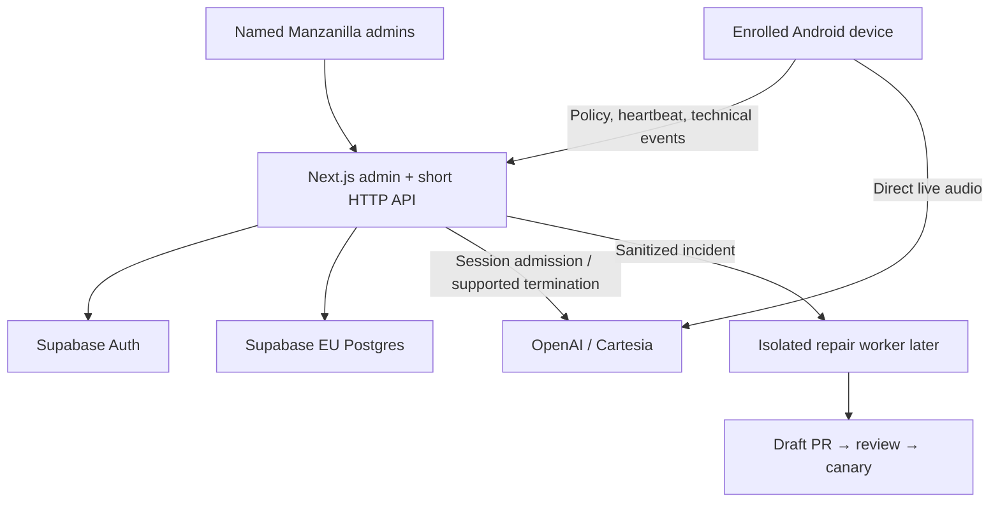

# Architecture decision

Build one small control-plane application. The portal answers four questions: **May this device use the service? Which feature is used? How much technical load is there? What needs attention?** Hotel records support filters and ownership; a hotel-management portal is out of scope.

## Local base now

The Next.js interface uses deterministic synthetic domain records and explicit simulation actions. No server authorization is implied by browser state. The domain layer owns policy transitions, analytics, telemetry validation and repair packets. The mockup and future database adapters share typed concepts; the demo is never a fallback for failed production authentication.

## Connected pilot later

Vercel hosts the interface and short control requests. Supabase stores records and named-admin identities. Choose a specific EU database region such as Frankfurt; a generic Europe option can include non-EU locations. Configure Vercel functions near that database (for example `fra1`) rather than relying on a US default. Review processing agreements, support access and subprocessor transfers; an EU primary region does not guarantee every operation stays in the EU or establish compliance by itself. Start without a VM, Redis, general event bus or audio proxy. Add a separate worker only for long-running repair work or measured ingestion demand.

Live audio goes directly from the Android device to the selected voice provider. The control plane admits new sessions and tracks provider handles where supported. This is an architectural separation, not a claim that Vercel cannot support WebSockets. Provider transports, ephemeral tokens, cancellation and their race behavior must be validated against the actual APK and provider account before enabling managed access.

## Trust and state

| State | Meaning | Source of truth |
|---|---|---|
| Desired access | Pending, approved or blocked by admin | Transactional database policy revision |
| Effective acknowledgement | Last policy the device confirmed | Authenticated ACK for that exact revision |
| Connectivity | Heartbeat freshness, never-seen or offline | Server receipt of a fresh heartbeat |
| Credential | Valid or revoked per installation | Server credential record |
| Provider stop | Confirmed, pending or unknown per tracked call | Provider response/reconciliation |

Blocking denies new authorized sessions immediately at the server. It requests local stop and provider termination separately. An offline device stays **confirmation pending**. An ACK does not prove a provider call ended. Revocation invalidates a credential; it is not a normal service toggle. Retain enrollment and hotel configuration when recovering from connectivity failures.

A legacy APK with embedded, unrestricted provider credentials can bypass the new broker. Mark it unmanaged until deliberately migrated. A dashboard cannot truthfully promise to stop that device.

## Data and privacy

Only two feature identifiers exist: `translation` and `reception`. Store technical session IDs, event IDs, builds, error codes, times, durations and numerical samples. Do not ingest audio, transcripts, prompts, names, room numbers, arbitrary log messages or provider response bodies. Browser/app errors must also pass the technical allowlist before storage.

Identifiers and operational metadata may still be personal data in context. Proposed pilot retention is **30 days for detailed technical events, 90 days for daily aggregates and 180 days for admin audit**, pending legal/business review and actual deletion jobs. Restrict staff access, record admin changes, establish a lawful basis and notices, review processor/subprocessor contracts and international transfers, and test deletion/export requirements. Do not record staff/guest surveillance or claim blanket GDPR compliance.

## Operational numbers

- A connected session is one logical session, even if its connection was retried.
- Attempts and failures count attempts; failed-attempt rate uses all attempts as denominator.
- Duration and first-audio timing have provenance/sample counts. Unknown is not zero.
- Traffic means control API/telemetry requests and session load. It is not visitor count, guest count, provider cost or whole-network inspection.
- API buckets are not attributed to a feature unless a measured contract provides that attribution.
- UTC reporting days are explicit. Historical uploads do not refresh presence.

## Repair and alerts

A serious incident starts a same-day response target. Configuration mistakes, hotel Wi-Fi loss and provider outages need runbooks, not speculative code patches. The current base prepares a sanitized brief only. Real notification delivery, alert acknowledgement/escalation and a watchdog outside the monitored service must be added before pilot operation. The future repair workflow is described in [repair-pipeline.md](repair-pipeline.md).

## Primary references

- [Next.js installation](https://nextjs.org/docs/app/getting-started/installation)
- [Supabase region choices](https://supabase.com/docs/guides/platform/regions)
- [Supabase data residency and transfers](https://supabase.com/legal/privacy-resources/data-residency-and-transfers-faq)
- [Vercel function region](https://vercel.com/docs/functions/configuring-functions/region)
- [Supabase row-level security](https://supabase.com/docs/guides/database/postgres/row-level-security)
- [GitHub Actions security](https://docs.github.com/en/actions/security-for-github-actions/security-guides/security-hardening-for-github-actions)
- [Vercel WebSocket support](https://vercel.com/docs/functions/websockets)

These references inform the foundation; provider integration and production SQL have not been exercised here.
