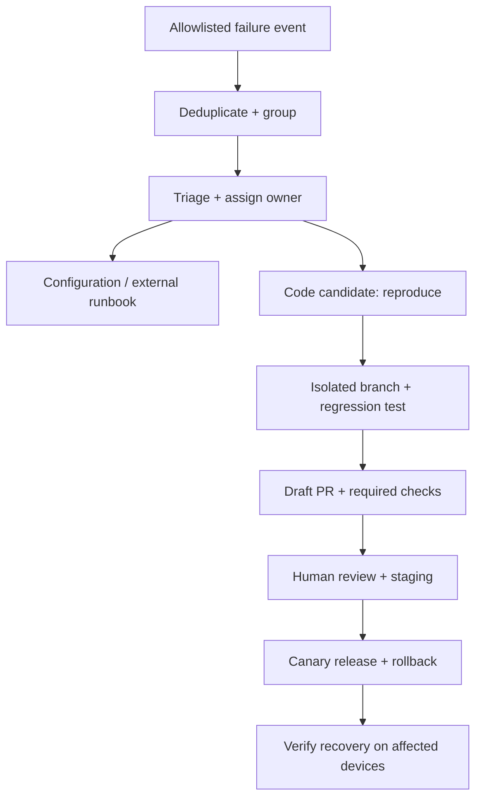

# Failure handling and future Codex workflow

The base groups typed technical failures and can prepare a repair brief. It has **no connected Codex service, GitHub write credential, issue creation, deploy or release path**. The manual `repair-intake` workflow only validates an incident reference and uploads a disconnected intake template.

## Route the problem first

| Failure type | First action | Code worker? |
|---|---|---|
| Hotel Wi-Fi / connectivity | Check reachability, backoff and hotel runbook | Only after a reproducible app defect is established |
| Microphone permission | Device setup/help flow | Usually no |
| Provider unavailable | Check authenticated provider status and retry policy | Usually no |
| Android audio startup regression | Reproduce against exact APK/build | Android handoff only in this project |
| Control-plane policy defect | Reproduce against this repository's exact commit | Candidate for new-repo repair |

“Same day” is an internal response/fix target. It cannot guarantee that hardware, network or external-provider outages are repairable that day. Give critical incidents an owner, response due time and escalation; resolved requires evidence, not a generated patch.

## Worker boundaries for a later implementation

1. Only a trusted server can enqueue an incident ID and immutable repository commit. Resolve both from an allowlist; device reports cannot pick repositories, URLs, branches, scripts or tools.
2. Build input from typed codes, versions, numeric metrics and approved reproduction templates. Treat it as data, not system instructions. Exclude raw logs, conversation text, credentials, guest data and provider bodies.
3. Reproduce in an ephemeral sandbox with least-privilege egress, a resource/time budget and no production secrets. Start with mocked providers. Approved live integration tests use separate scoped test credentials outside PR logs.
4. Patch only the selected new admin repository. Run meaningful regression tests and required CI. Stop and request a handoff when a failure belongs to Android or a provider. Do not touch the old Manzanilla repository.
5. Publish a draft PR through a separately scoped GitHub App only after checks; the worker cannot merge, alter branch protections, modify its own authority or release. Review workflow/credential changes separately.
6. Deploy to staging/canary through a trusted release workflow after approval. Verify error rate, device policy ACK and affected feature recovery against the rollout cohort. Roll back on regression. Never mark resolved from CI alone.

Keep a durable incident state machine, retries with bounded backoff and an append-only audit. Add alert deduplication, an out-of-band receiver and a watchdog that can report when the portal itself stops. Those are production prerequisites, not current demo behavior.
